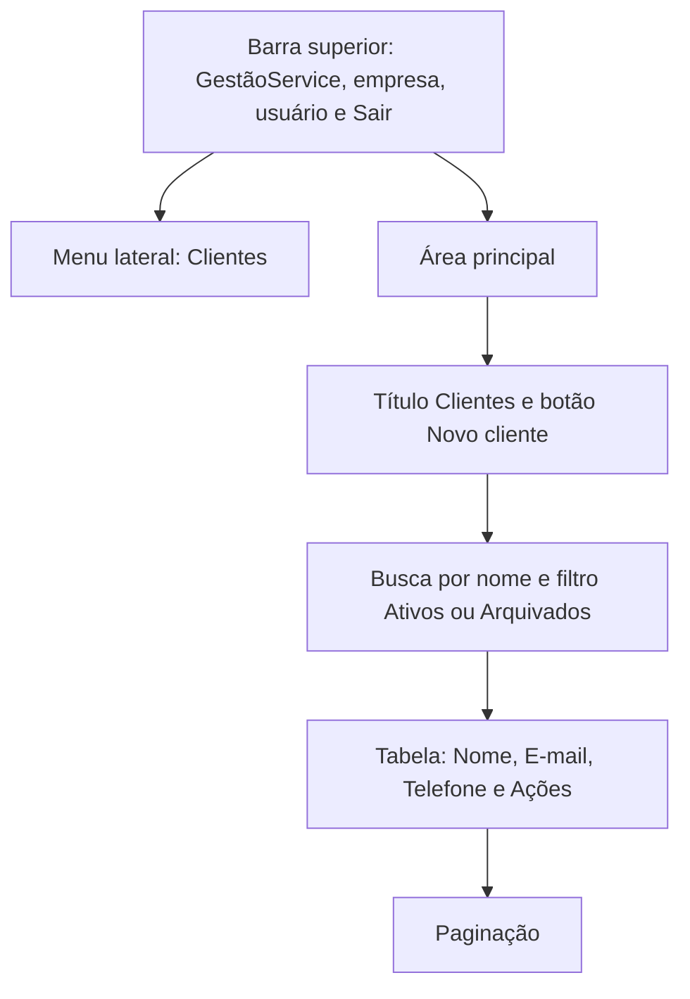

# Planejamento das telas — V0.1

Status: proposta inicial, ainda não implementada.

## 1. Login

Objetivo: permitir a entrada de um usuário cadastrado.

Elementos:
- Nome GestãoService.
- Campo de e-mail.
- Campo de senha.
- Botão Entrar.
- Link Esqueci minha senha.

Estados:
- Aguardando preenchimento.
- Enviando: botão desabilitado para evitar envio repetido.
- Erro de autenticação.
- Erro de conexão.

Após entrar, o usuário será direcionado para Clientes.

## 2. Recuperação de senha

Objetivo: solicitar um link para redefinir a senha.

Elementos:
- Campo de e-mail.
- Botão Enviar link.
- Link Voltar para o login.

A mensagem de confirmação será genérica, sem revelar
se o e-mail está cadastrado.

## 3. Redefinição de senha

Objetivo: definir uma nova senha após acessar o link recebido.

Elementos:
- Campo Nova senha.
- Campo Confirmar senha.
- Botão Salvar nova senha.

Estados:
- Link válido.
- Link inválido ou expirado.
- Erro de validação.
- Salvamento em andamento.
- Confirmação de alteração.

## 4. Clientes

Objetivo: consultar e organizar os clientes da empresa.

Elementos:
- Identificação da empresa e do usuário.
- Navegação com a opção Clientes.
- Botão Sair.
- Título Clientes.
- Botão Novo cliente.
- Busca por nome.
- Filtro Ativos ou Arquivados.
- Tabela com nome, e-mail, telefone e ações.
- Paginação.

Ações para clientes ativos:
- Editar.
- Arquivar com confirmação em modal.

Ações para clientes arquivados:
- Restaurar.

Estados:
- Carregando.
- Nenhum cliente cadastrado.
- Nenhum resultado para a busca.
- Falha ao carregar, com opção de tentar novamente.
- Lista carregada.

## 5. Cadastro e edição de cliente

Objetivo: cadastrar ou atualizar um cliente.

A primeira proposta usará uma página própria para o formulário.

Campos:
- Nome: obrigatório.
- E-mail: opcional, com validação quando preenchido.
- Telefone: opcional.

Elementos:
- Título indicando cadastro ou edição.
- Botão Salvar.
- Botão Cancelar.

Comportamentos:
- Mostrar erros próximos dos campos.
- Preservar os dados preenchidos quando houver falha.
- Desabilitar o envio enquanto estiver salvando.
- Exibir confirmação após salvar.
- Retornar à listagem após sucesso.

## 6. Componentes compartilhados

- Botão.
- Campo de formulário com label e mensagem de erro.
- Tabela.
- Paginação.
- Modal de confirmação.
- Toast de feedback.
- Indicador de carregamento.
- Mensagem de estado vazio.
- Mensagem de erro com ação para tentar novamente.

## 7. Diretrizes de uso

- Campos terão labels visíveis.
- A navegação deverá funcionar por teclado.
- O foco deverá ser visível.
- Informações não dependerão somente de cores.
- Modais deverão controlar e devolver o foco.
- Em telas pequenas, os formulários ocuparão a largura disponível.
- Tabelas deverão permitir consulta sem cortar as ações.

  ## Esboço da tela de Clientes

O diagrama representa a hierarquia dos elementos.
No computador, o menu ficará ao lado da área principal.
No celular, será recolhido em um menu.

### Comportamento das ações

- Novo cliente abre a página de cadastro.
- Editar abre o formulário preenchido.
- Arquivar abre um modal de confirmação.
- Restaurar devolve o cliente à lista de ativos.
- Sair encerra a sessão.

### Aplicação do padrão visual

As cores serão consumidas exclusivamente por variáveis CSS com var().
Os valores da paleta ficarão centralizados no arquivo global de estilos,
conforme docs/padrao-visual.md.

## Organização visual das telas de autenticação

As telas terão um cartão centralizado, com largura máxima de 420px.
No celular, o cartão ocupará a largura disponível, mantendo margens.

### Login — ordem dos elementos

1. Nome GestãoService.
2. Título Entrar.
3. Campo E-mail.
4. Campo Senha.
5. Link Esqueci minha senha.
6. Botão Entrar, ocupando a largura do cartão.
7. Área para mensagem de erro.

### Recuperação de senha — ordem dos elementos

1. Nome GestãoService.
2. Título Recuperar senha.
3. Instrução para informar o e-mail.
4. Campo E-mail.
5. Botão Enviar link.
6. Mensagem de confirmação ou erro.
7. Link Voltar para o login.

### Redefinição de senha — ordem dos elementos

1. Nome GestãoService.
2. Título Definir nova senha.
3. Campo Nova senha.
4. Campo Confirmar senha.
5. Botão Salvar nova senha.
6. Mensagem de confirmação ou erro.

Se o link estiver inválido ou expirado, apresentar uma explicação
e uma opção para solicitar outro link.

## Organização visual do formulário de cliente

A página utilizará a mesma barra superior e navegação da listagem.

O formulário terá largura máxima de 640px e campos em uma coluna.

Ordem dos elementos:

1. Link Voltar para clientes.
2. Título Novo cliente ou Editar cliente.
3. Campo Nome, identificado como obrigatório.
4. Campo E-mail, identificado como opcional.
5. Campo Telefone, identificado como opcional.
6. Área para erro geral de salvamento.
7. Botões Cancelar e Salvar.

Erros de validação aparecerão abaixo dos respectivos campos.
Falhas no salvamento não apagarão os dados preenchidos.

## Regras visuais compartilhadas

- Todas as cores serão aplicadas por variáveis CSS com var().
- Valores de cor ficarão centralizados na definição da paleta.
- Botões, campos e mensagens seguirão docs/padrao-visual.md.
- Todos os controles terão indicação de foco por teclado.
- Mensagens de erro não dependerão somente da cor.
- Estados de envio terão indicação textual de progresso.
